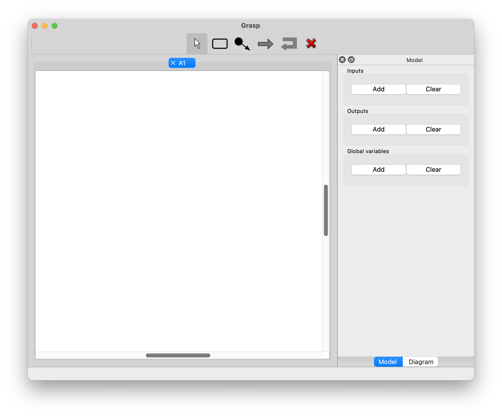
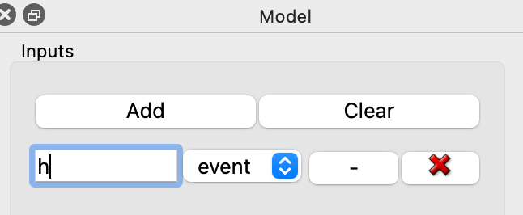
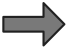
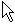
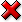
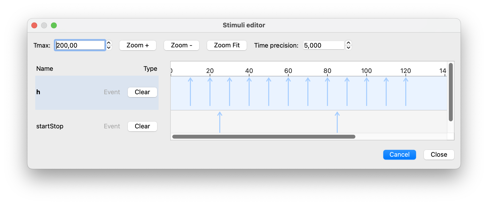

# Basic concepts

**Grasp** manipulates _models_. A _model_ is a collection of _diagrams_ with a set of global
_inputs_, _outputs_ and (shared) _variables_. I/Os and variables are typed. _Stimuli_ can be
attached to global inputs to perform simulations of the model. 

## Creating a model

After launching the application, invoke the `New model` action from the `File` menu. This creates a
new model, with a single diagram, and add two panels in the main window : one for editing this diagram
and another for editing the globals I/Os and variables of the model.

## Adding I/Os

Click the `Add` button in the `Model` panel (this panel is _dockable_ window; it can be detached
from the main window if necessary and/or closed by (un)selecting the `Model` item in the `View`
menu).

When adding an input, output or global (shared) variable, give its name and type. A name already used by
another input, output or variable is shown with a red frame and an explanation under the panel; if it is not
corrected, the previous name is restored when leaving the field.

For inputs, it's possible to also attach stimuli (this is only required for simulating the model) : see
[Attaching stimuli to inputs](#attaching-stimuli-to-inputs) below. Changing the type of an input deletes its
stimuli (after confirmation), since they are only meaningful for the previous type.

## Adding a state to a diagram 

Select the  button in the toolbar and click on the
  diagram editing panel. A pop-up dialog gives the opportunity to set the name of the added state and,
  possibly, to attach output valuations. Click `Done` when finished. An invalid or already used name is
  shown with a red frame (and `Done` is disabled) until it is corrected; invalid valuations are shown in
  the same way, with an explanation under the list, when clicking `Done`.

## Adding a transition to a diagram 

Select the  button, click on
  the start state and, keeping the mouse button pressed, go the end state and release mouse button.
  A popup dialog gives the opportunity to document the transition, by specifiying the triggering
  event and the associated guards and actions. Note that adding a transition requires that at least
  one input with type `event` has been attached to the model. As for states, click `Done` when
  finished : invalid guards or actions are then shown with a red frame, with an explanation under the
  list, and the dialog is left opened until they are corrected. Each guard and each action must be
  given on its own row (commas are not allowed).

To add a **self transition** (from a state to itself) , select the  button
  and click on start state (the location of the click will decide on that of the transition).

To add an **initial transition**, select the  button, click near the
  initial state and, keeping the mouse button pressed, go the  initial state and release mouse
  button. A pop-up dialog gives the opportunity to add actions to the initial transition.
  Click `Done` when finished.

To **move a state**, select the  button and drag the state.

## Editing a state or a transition

Select the  button, and right-click (or Ctl-Click on a Mac) on the corresponding item 

## Deleting a state or a transition

select the  button
and click on the state or transition (deleting a state will also delete all incoming and
outcoming transitions)

## Changing the name of the diagram or add local variables

The name and local variables of the current diagram are shown in the `Diagram` panel, next to
the `Model` panel (click on its tab to show it). The panels can be shown or hidden from the `View` menu.

Right-clicking on the background of a diagram also shows this panel, and opens a menu for changing
the zoom of the diagram, adding a new diagram, duplicating, deleting or checking the diagram.

## Adding / removing a diagram from a model

For adding a new diagram, invoke the `Add diagram to model` action from the `Model` menu (or the `New
diagram` entry of the menu opened by right-clicking on the background of a diagram). The new diagram is
given a default name, which can be changed in the `Diagram` panel.

Adding a diagram can also be performed by invoking the `Duplicate current diagram` action from the
`Model` menu (or the `Duplicate diagram` entry of the right-click menu). In this case, the added diagram
is a copy of the current one. The `Diagram` panel is then shown, with its name selected, so that it can be
renamed accordingly.

For removing a diagram, click on the close button of its tab (or select the `Delete diagram` entry of the
right-click menu) and confirm.

## Saving and loading

* Models can be saved to (resp. read from) files by invoking the `Save` or `Save as` (resp. `Open`)
  actions from the `File` menu. 
  
## Compiling

The `Compile` menu is used to generate various representations of the model and to simulate it. 

Compilation options can be adjusted, for each target representation, by invoking the `Compiler
options` action from the `Configuration` menu.

### DOT

The `Generate DOT representation` action is used to produce a `.dot` representation, to be viewed by
the `Graphviz` set of tools. By default, this action generates a `.gif` image which is displayed in
a separate window. For this to work, the path to the `dot` program must have been correctly set in
the `Compiler paths` window accessible from the `Compiler and tools` action of the `Configuration`
menu.

It is also possible to view the `.dot` file using the `Graphviz` application. For this, select
the `-dot_external_viewer` option in the `General` tab of the `Compiler options` window accessible
from the `Configuration` menu. Again, for this to work, the path to the `graphviz` application must
have been correctly set in the `Compiler paths` window accessible from the `Compiler and tools`
action of the `Configuration` menu.

The`Generate DOT representation` generates a single file, in which the diagrams composing a model
are displayed as sub-graphs ("clusters"). It is sometimes useful to generate separates `.dot` files for
each diagram. For this, invoke the `Generate separate DOT representation` action. 

### CTask, SystemC and VHDL

Invoke the corresponding action in the `Compile` menu. The generated code is produced in a separate
window. When multiple files are produced, these files are displayed in separate tabs. 

For `SystemC` and `VHDL`, the generated code may include or not a testbench for simulation.

### RFSM

The `Generate RFSM code` generates the representation of the model for the
[rfsmc](https://github.com/jserot/rfsm) compiler. This representation is that used internally to
compile the model to other formats. It normally won't be used by the casual user.
  
## Attaching stimuli to inputs

In the `Model` panel, each input has a button labelled `Stim` if stimuli are attached to it, `-` otherwise
(the number of stimuli is given in its tooltip). Clicking on this button opens the stimuli editor, which
shows the stimuli of all the inputs as chronograms (one track per input), the track of the clicked input
being highlighted.

In this editor :
- a left click in a track adds a stimulus at the corresponding date (an event for an input with type
  `event`, a value change otherwise). A dialog lets the date (and, for a value change, the value) be
  adjusted. The clicked date is rounded to the nearest multiple of the `Time precision` value (0 for no
  rounding)
- a left click on an existing stimulus edits it, a right click deletes it (after confirmation)
- a right click in an empty part of an event track fills it with periodic events (start date, period and
  end date are asked in a dialog)
- the `Clear` button of a track deletes all its stimuli (after confirmation)
- `Tmax` sets the displayed time range, and the `Zoom +`, `Zoom -` and `Zoom Fit` buttons its scale

Click `Close` to apply the changes (or `Cancel` to discard them). The dates of the stimuli are then rounded
to integers and the values of boolean inputs set to 0 or 1, the adjustments, if any, being reported.

## Simulating

Provided that stimuli have been attached to inputs (see above), the model can be simulated by invoking the
`Run simulator` action of the `Compile` menu.

The generated `.vcd` file is the passed to the corresponding viewer application (as specified in the
`Compiler paths` window accessible from the `Compiler and tools` action from the `Configuration`
menu). 

# Trouble-shooting, debugging

When running, the application writes a log file, named `grasp.log`, which can be inspected to
diagnose problems. This file is located
- in `~/.local/share/grasp/` under Linux
- in `~/Library/Application Support/grasp/` under MacOS
- in `C:\Users\<User>\AppData\Roaming\grasp\` under Windows.

This file is overwritten each time the application is launched: copy it before launching the
application again if its content is needed.

The most common problems are due to wrong locations of the `dot` and `gtkwave` external tools
(used, respectively, to display the FSM diagrams and the simulation results). Check the paths
by choosing `Compiler and tools` in the `Configuration` menu.

Another possible cause is an invalid (or already used) port number for the socket used to communicate
with the underlying `rfsmc` compiler server (default value: 51000). In this case, change the
`SOCKETPORT` entry of the application configuration file `grasp.conf`, located
- in `~/.config/grasp/` under Linux
- in `~/Library/Preferences/grasp/` under MacOS
- in `C:\Users\<User>\AppData\Roaming\grasp\` under Windows.

Since all the instances of the application use the same port, only one of them can run at a time.
